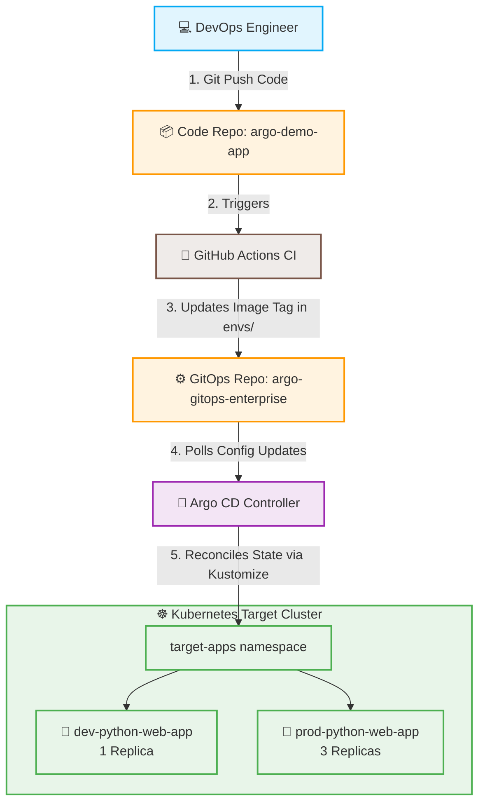

# argo-gitops-enterprise
# 🏢 Enterprise Multi-Environment GitOps Architecture (`argo-gitops-enterprise`)



This repository serves as the **Declarative Single Source of Truth** for a multi-environment Kubernetes infrastructure deployment. It utilizes **Kustomize** to manage variations across testing and production environments dynamically without code duplication.

## 📂 Repository Directory Breakdown

* **/base**: The structural foundation templates (`Deployment`, `Service`) shared globally by all runtime scopes.
* **/envs/dev**: Development overlay. Appends the `dev-` naming convention prefix and constraints cluster resource overhead to **1 active replica pod**.
* **/envs/prod**: Production high-availability overlay. Appends the `prod-` prefix and scales workloads to **3 distributed replica pods**.
* **/argocd-apps**: Declarative bootstrap manifests allowing Argo CD to natively mount and orchestrate both lifecycles cleanly.

## ⚙️ Declarative Deployment Setup

To ingest this infrastructure blueprint directly into an active Argo CD cluster:

```bash
# Apply both environment tracks simultaneously
kubectl apply -f argocd-apps/
```

## 🌟 Core AWS SAA-C03 Architectural Alignments Demonstrated
* **Decoupled Architecture:** Strict logical separation between continuous integration pipelines and continuous delivery states.
* **High Availability Configuration:** Dynamic vertical scale adjustments targeting and production environments dynamically without code duplication.


